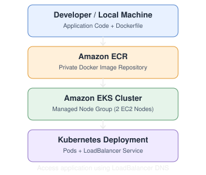

# AWS ECR + EKS Project: Docker Image Deployment on Kubernetes

Project Title: Deploy a Dockerized Web Application on Amazon EKS Using Amazon ECR

Objective: Build a Docker image, store it in a private Amazon ECR repository, create an EKS cluster with managed worker nodes, and deploy the application using Kubernetes.

## 1. Architecture



## 2. Prerequisites

| Tool    | Purpose                     |
| ------- | --------------------------- |
| AWS CLI | Manage AWS resources        |
| Docker  | Build and push images       |
| kubectl | Manage Kubernetes           |
| eksctl  | Create EKS cluster          |
| AWS IAM | Permissions for ECR and EKS |

### Install tools on macOS

```
brew install awscli
brew install kubectl
brew install eksctl
brew install --cask docker
```

### Verify installation

```
aws --version
docker --version
kubectl version --client
eksctl version
```

### Configure AWS CLI

```
aws configure
```

Enter AWS Access Key, Secret Key, default region `us-east-1`, and output format `json`. Use credentials from an authorized IAM identity; temporary credentials through AWS IAM Identity Center are preferable for regular use.

```
aws sts get-caller-identity
```

## 3. Project Structure

```
ECR-EKS-Project/
├── index.html
├── Dockerfile
└── kubernetes/
    ├── deployment.yaml
    └── service.yaml
```

## 4. Project Code

### File 1: index.html

```
<!DOCTYPE html>
<html>
<head>
    <title>AWS ECR EKS Project</title>
    <style>
        body {
            font-family: Arial;
            text-align: center;
            background: #f4f6f8;
            padding: 80px;
        }
        h1 { color: #ff9900; }
    </style>
</head>
<body>
    <h1>Welcome to AWS EKS</h1>
    <h2>Docker + Amazon ECR + Kubernetes</h2>
    <p>Application deployed successfully!</p>
</body>
</html>
```

### File 2: Dockerfile

```
FROM nginx:stable-alpine
COPY index.html /usr/share/nginx/html/index.html
EXPOSE 80
```

## 5. Create Amazon ECR Repository

Definition: Amazon Elastic Container Registry (ECR) is a managed AWS container registry for storing, managing, and retrieving container images.

### Set environment variables

```
export AWS_REGION=us-east-1
export AWS_ACCOUNT_ID=$(aws sts get-caller-identity --query Account --output text)
export ECR_REPO=mywebapp
export IMAGE_TAG=v1
export ECR_URI=$AWS_ACCOUNT_ID.dkr.ecr.$AWS_REGION.amazonaws.com/$ECR_REPO
```

### Create private repository

```
aws ecr create-repository \
  --repository-name mywebapp \
  --region us-east-1
```

### List repositories

```
aws ecr describe-repositories \
  --region us-east-1
```

### Authenticate Docker with ECR

```
aws ecr get-login-password --region us-east-1 \
| docker login \
  --username AWS \
  --password-stdin \
  $AWS_ACCOUNT_ID.dkr.ecr.us-east-1.amazonaws.com
```

## 6. Build, Tag and Push Docker Image

### Build image

```
docker build -t mywebapp:v1 .
```

For a Mac with Apple Silicon and EKS x86 worker nodes, use:

```
docker build --platform linux/amd64 -t mywebapp:v1 .
```

### Verify image

```
docker images
```

### Test locally

```
docker run -d --name mywebapp-test -p 8080:80 mywebapp:v1
```

Open `http://localhost:8080`.

### Tag image for ECR

```
docker tag mywebapp:v1 $ECR_URI:v1
```

### Push image to ECR

```
docker push $ECR_URI:v1
```

### Verify image in ECR

```
aws ecr list-images \
  --repository-name mywebapp \
  --region us-east-1
```

## 7. Create Amazon EKS Cluster

Definition: Amazon Elastic Kubernetes Service (EKS) is a managed Kubernetes service that simplifies running Kubernetes clusters on AWS.

### Create cluster with managed node group

```
eksctl create cluster \
  --name mycluster \
  --region us-east-1 \
  --nodegroup-name mynodes \
  --node-type t3.medium \
  --nodes 2 \
  --nodes-min 2 \
  --nodes-max 2 \
  --managed
```

Cluster creation can take several minutes and incurs AWS charges.

### Configure kubectl

```
aws eks update-kubeconfig \
  --name mycluster \
  --region us-east-1
```

This configures the local kubeconfig file to authenticate with the EKS Kubernetes API.

### Verify cluster

```
kubectl cluster-info
kubectl get nodes
kubectl get namespaces
```

### Check EKS cluster status

```
aws eks describe-cluster \
  --name mycluster \
  --region us-east-1 \
  --query 'cluster.status'
```

### Check managed node group

```
eksctl get nodegroup \
  --cluster mycluster \
  --region us-east-1
```

## 8. Deploy ECR Image to EKS

EKS worker nodes require permission to pull images from private ECR. The standard managed node IAM role uses `AmazonEC2ContainerRegistryPullOnly` for this purpose. Normally, no Kubernetes image pull secret is required when node IAM permissions are correctly configured.

### File 3: kubernetes/deployment.yaml

Replace `ACCOUNT_ID` with your AWS account ID.

```
apiVersion: apps/v1
kind: Deployment
metadata:
  name: mywebapp
spec:
  replicas: 2
  selector:
    matchLabels:
      app: mywebapp
  template:
    metadata:
      labels:
        app: mywebapp
    spec:
      containers:
        - name: mywebapp
          image: ACCOUNT_ID.dkr.ecr.us-east-1.amazonaws.com/mywebapp:v1
          ports:
            - containerPort: 80
```

Alternatively, substitute the account ID automatically:

```
sed -i.bak "s/ACCOUNT_ID/$AWS_ACCOUNT_ID/g" kubernetes/deployment.yaml
```

### File 4: kubernetes/service.yaml

```
apiVersion: v1
kind: Service
metadata:
  name: mywebapp-service
spec:
  type: LoadBalancer
  selector:
    app: mywebapp
  ports:
    - port: 80
      targetPort: 80
      protocol: TCP
```

### Deploy application

```
kubectl apply -f kubernetes/deployment.yaml
kubectl apply -f kubernetes/service.yaml
```

### Verify resources

```
kubectl get deployments
kubectl get pods
kubectl get services
kubectl get nodes -o wide
```

### Check deployment rollout

```
kubectl rollout status deployment/mywebapp
```

### Access application

```
kubectl get svc mywebapp-service
```

Wait for the external LoadBalancer hostname to appear, then open it in a browser.

## 9. Kubernetes Practice Commands

| Task               | Command                                          |
| ------------------ | ------------------------------------------------ |
| List pods          | `kubectl get pods`                               |
| List nodes         | `kubectl get nodes`                              |
| List deployments   | `kubectl get deployments`                        |
| List services      | `kubectl get svc`                                |
| Pod details        | `kubectl describe pod POD_NAME`                  |
| Pod logs           | `kubectl logs POD_NAME`                          |
| Scale application  | `kubectl scale deployment mywebapp --replicas=3` |
| Check rollout      | `kubectl rollout status deployment/mywebapp`     |
| Restart deployment | `kubectl rollout restart deployment/mywebapp`    |
| Delete pod         | `kubectl delete pod POD_NAME`                    |

### Troubleshoot image pull errors

```
kubectl describe pod POD_NAME
```

Check that the image URI and tag exist, the node IAM role has ECR pull permissions, and the nodes have network access to ECR and S3.

## 10. Points to Remember

| Topic              | Important Point                                   |
| ------------------ | ------------------------------------------------- |
| ECR                | Stores container images                           |
| Private ECR        | Requires AWS authentication and IAM authorization |
| Docker build       | Creates a container image                         |
| Docker tag         | Assigns the ECR image URI                         |
| Docker push        | Uploads image to ECR                              |
| EKS                | AWS-managed Kubernetes control plane              |
| Managed node group | AWS-managed lifecycle of EC2 worker nodes         |
| kubeconfig         | Configures access to Kubernetes API               |
| kubectl            | Manages Kubernetes resources                      |
| Deployment         | Maintains desired number of Pods                  |
| Pod                | Smallest deployable Kubernetes unit               |
| LoadBalancer       | Exposes application externally                    |
| Node IAM role      | Enables worker nodes to pull private ECR images   |

Important: ECR and EKS must use compatible region and image configurations. For this lab, the ECR repository and EKS cluster both use `us-east-1`.

## 11. Cleanup Commands

Delete Kubernetes resources first:

```
kubectl delete -f kubernetes/
```

Delete EKS cluster:

```
eksctl delete cluster \
  --name mycluster \
  --region us-east-1
```

Delete ECR repository and images:

```
aws ecr delete-repository \
  --repository-name mywebapp \
  --region us-east-1 \
  --force
```

Remove local Docker test container:

```
docker rm -f mywebapp-test
```

Verify the EKS cluster, load balancer, and associated AWS resources are deleted to avoid unnecessary charges.

## 12. Practical Assignments

- Assignment 1: Create a private ECR repository using AWS CLI.
- Assignment 2: Build and push an Nginx Docker image to ECR.
- Assignment 3: Create an EKS cluster with two managed worker nodes.
- Assignment 4: Configure kubectl and verify nodes.
- Assignment 5: Deploy the ECR image using Kubernetes Deployment.
- Assignment 6: Expose the application using a LoadBalancer Service.
- Assignment 7: Scale the application from 2 to 3 replicas.
- Assignment 8: Update the HTML page, build image `v2`, push to ECR, and update the Kubernetes Deployment.
- Assignment 9: Verify the application and clean up AWS resources.

Final Learning Flow: AWS CLI → Docker → ECR → EKS → Managed Node Group → kubectl → Kubernetes Deployment → Service → Application Access → Cleanup.
